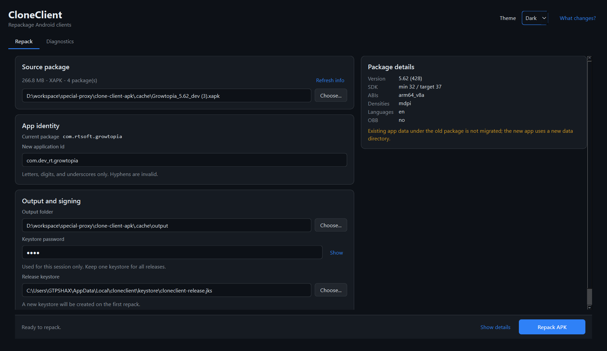

# CloneClient

A desktop APK repackager built with PySide6 and packaged as a standalone Windows executable.


## Features

- Repack tab: select one XAPK or APK, inspect it, merge splits, fully rename the package, optionally replace the launcher name, icon, and native server hosts, sign, and verify.
- Optional app name and launcher icon replacement. Icons are resized into mdpi, hdpi, xhdpi, xxhdpi, and xxxhdpi mipmap resources.
- Optional replacement of `www.growtopia1.com` and `www.growtopia2.com` inside native libraries. Each replacement must be exactly 18 characters.
- Diagnostics tab with clipboard copy.
- Light and dark theme, window geometry, output directory, and keystore path persisted in `%LOCALAPPDATA%\cloneclient\settings.json`.
- File logging and a global crash handler that records unhandled exceptions.
- Self-contained executable: the pinned Temurin 21 runtime and the pinned Java tools are bundled, so users do not install Java or download JARs.

## Requirements

### Packaged executable

- Windows x64.
- No Java, Python, uv, or network access is required at runtime.
- Enough free disk for the input XAPK, temporary files, and output APK. The sample XAPK is 267 MB and the output is around 245 MB.
- A `.xapk` or `.apk` that you have the right to modify.

### Development and build

- Windows x64, Python 3.12, uv, and network access for the pinned JAR and JDK downloads.
- A JDK 17 or newer is only needed for source runs before the bundled runtime has been built. The build creates `runtime/` from a pinned Temurin 21 release.

Python dependencies include `pyaxmlparser` for manifest parsing and `lief` for ELF symbol rewriting.

## Development

```bash
uv sync
uv run python scripts/fetch_tools.py
uv run python scripts/fetch_jdk.py
uv run python -m cloneclient
```

The source run prefers `runtime/bin/java.exe` when it exists, so the development build exercises the same runtime as the executable.

## Repack workflow

1. Open the Repack tab.
2. Choose an `.xapk` or `.apk`, or drop it on the source card. Inspection runs automatically.
3. Review Package details and the rename warning.
4. Set the output folder, application id, optional app name, icon, Server 1, Server 2, and keystore password. The application id must be exactly the same length as the source package. Server values must be exactly 18 characters. The keystore password must be at least 6 characters. The keystore alias stays under Advanced.
5. Click Repack APK. Merge, decode, rename, appearance, rebuild, sign, and verify run with a visible stage list. Cancel is available while the job runs.
6. On success, use Open folder or Copy path. On failure, use Try again and open the details for the full log.

Keyboard: `Ctrl+O` chooses a package, `Ctrl+R` repacks, `Esc` cancels.

The design rationale, state model, and screenshots are in `docs/ux.md`.



## Rename behavior

- The manifest `package`, component names, authorities, permissions, `targetPackage`, and `sharedUserId` move to the new application id.
- Java classes and smali directories move from `com.rtsoft.growtopia` to `com.dev_rt.growtopia`.
- The new application id must be exactly the same length as the source package: 20 characters for `com.rtsoft.growtopia`, and the prefix before the last segment must stay 11 characters. A mismatch is rejected before the pipeline starts.
- Optional appearance: the app name replaces the application and launcher labels. The chosen image becomes a new `@mipmap/cloneclient_icon` resource at five densities, and the application and launcher icon references point to it. The original icon files remain in the APK but are unused.
- Optional server endpoints: Server 1 and Server 2 replace `www.growtopia1.com` and `www.growtopia2.com` inside every native library that contains them. Both values use the same 18-character length, so the replacement stays in place.
- `resources.arsc` is rebuilt with the new package name.
- `libgrowtopia.so` is rewritten in place. Every string replacement keeps the original length, so offsets do not move:
  - The 32 `Java_com_rtsoft_growtopia_*` dynamic symbols become `Java_com_dev_1rt_growtopia_*` through LIEF, which also rebuilds the ELF hash tables.
  - Full package strings, path strings, and the partial `com.rtsoft.` prefix become `com.dev_rt.growtopia`, `com/dev_rt/growtopia`, and `com.dev_rt.`.
- Old JNI names may remain as string literals in `.rodata`. They are not dynamic symbols and are not used for lookup; the verifier checks the dynamic symbol table.
- The new data directory is `Android/data/com.dev_rt.growtopia`. Existing data under the old package is not migrated.
- The APK is re-signed, so it cannot update the original app in place.

## CLI

```bash
uv run python -m cloneclient --tool-check
uv run python -m cloneclient --inspect ".cache/Growtopia_5.62_dev (3).xapk"
uv run python -m cloneclient --smoke
uv run python -m cloneclient --crash-test
```

A windowed build has no console, so `--tool-check` writes `%LOCALAPPDATA%\cloneclient\tool-check.txt` and `--inspect` writes `inspect-report.txt` next to it.

## Quality checks

```bash
uv run ruff check src tests scripts build.py
uv run ruff format --check src tests scripts build.py
uv run pytest
uv run python scripts/check_style.py
```

The end-to-end repack test is opt-in because it needs a large XAPK. It uses the bundled runtime when `runtime/` exists, otherwise a host JDK 17 or newer:

```bash
CLONECLIENT_RUN_SLOW=1 uv run pytest tests/integration/test_repack_pipeline.py -q
```

## Build

```bash
uv run python build.py
```

The executable is written to `dist/CloneClient.exe`. The build downloads and verifies the pinned Temurin 21 JDK, creates a minimal runtime with `jlink`, and bundles the runtime under `runtime/` and the pinned JAR files under `tools/`. The first build needs network access and roughly 1 GB of cache space under `.cache/jdk`; later builds reuse the cached JDK and runtime. The one-file executable is around 122 MB and requires no host JDK. LIEF is bundled as a Python extension. Build on Windows x64 only, because PyInstaller does not cross-compile.

`--tool-check` reports the bundled runtime path, the bundled JARs, and `keytool` from the same runtime. Ship `THIRD_PARTY_NOTICES.md` with the executable.

## Limitations

- OBB data is not embedded. The tool reports a warning when OBB files are present.
- Server-side integrity or future client-side anti-tamper logic is outside the tool.
- User data is not migrated from the old package path.
- The operator must have the right to modify and distribute the APK.
- The executable is unsigned. SmartScreen may warn about it.
- The single-file executable extracts the bundled runtime to the temporary directory on each launch, so the first window can take a few seconds to appear.
